<p align="center">
  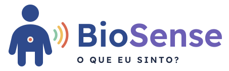
</p>

<p align="center">
  <strong>Um boneco 3D que ajuda crianças a dizer o que sentem, onde sentem e quanto sentem.</strong><br>
  FMU Tech Inovação 2026.2 · BioDesign Inclusivo (Compartilhe Docência Level Up) · ODS 3 e ODS 4
</p>

<p align="center">
  <a href="#protótipo-v1-checkpoint-2">Protótipo</a> ·
  <a href="#como-executar">Como executar</a> ·
  <a href="#1-descrição-do-problema">Problema</a> ·
  <a href="#2-proposta-de-solução-tecnológica">Solução</a> ·
  <a href="#3-identidade-visual">Identidade visual</a> ·
  <a href="#4-pitch-inicial">Pitch</a> ·
  <a href="#5-equipe">Equipe</a> ·
  <a href="#6-organização-do-repositório">Repositório</a>
</p>

<p align="center">
  <a href="https://joaorossoni1-eng.github.io/biosense/"><strong>▶ Abrir o protótipo</strong></a> ·
  <a href="LINK_DO_VIDEO"><strong>🎬 Vídeo de demonstração</strong></a>
</p>

---

## Status

| Etapa | Período | Situação |
|---|---|---|
| Checkpoint 1 — Ideação | 19/10 a 23/10 | ✅ Entregue |
| **Checkpoint 2 — Protótipo V1** | 09/11 a 13/11 | ✅ Protótipo funcional neste repositório |
| BioDesign Day / Apresentação final | 07/12 e 08/12 | ⏳ V2 após testes e feedback |

---

## Protótipo V1 (Checkpoint 2)

O BioSense V1 é uma aplicação web em 3D que **executa o fluxo principal de ponta a ponta**: a criança toca no boneco, escolhe a sensação e a intensidade, e o app mostra e fala a frase completa.

| Fluxo principal | |
|---|---|
| **Escolha do boneco** | **Menino ou menina**, para a criança se reconhecer. A escolha fica salva no aparelho |
| **1. Onde?** | Toque direto no boneco 3D (detecção por *raycasting*) ou nos 9 botões com mini-boneco. A região acende devagar, sem flash, e o nome é falado |
| **2. O quê?** | 6 sensações com pictograma + nome + voz: dor, fome, sede, enjoo, frio, calor |
| **3. Quanto?** | 3 níveis com **cor + número de bolinhas + altura da barra + voz**. O boneco já pinta a região na cor do nível |
| **Resumo** | "Eu sinto dor na barriga. Muito." em texto grande e em voz, com a região pulsando devagar no boneco. Botões: ouvir de novo, saber mais, contar outra coisa, trocar a resposta |
| **Modo Descobrir** | Explicação curta de cada sensação, em texto e voz, com as partes do corpo envolvidas destacadas no boneco |

### Prints

| Onde? | O quê? | Quanto? |
|---|---|---|
| 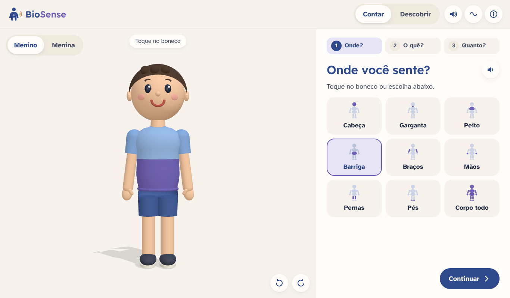 | 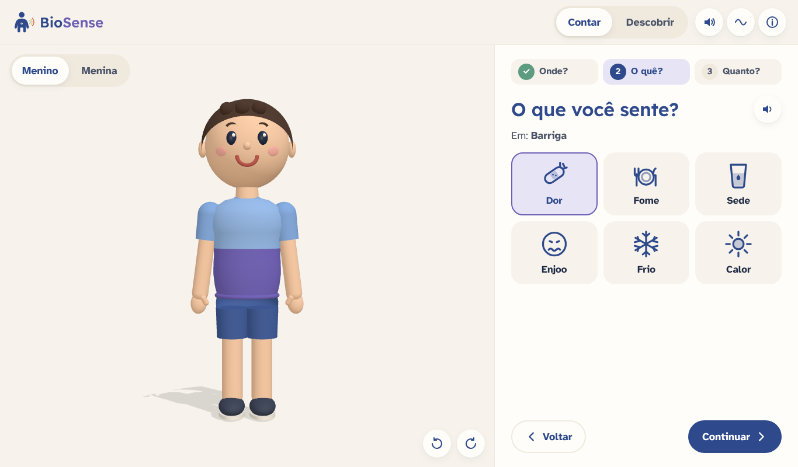 | 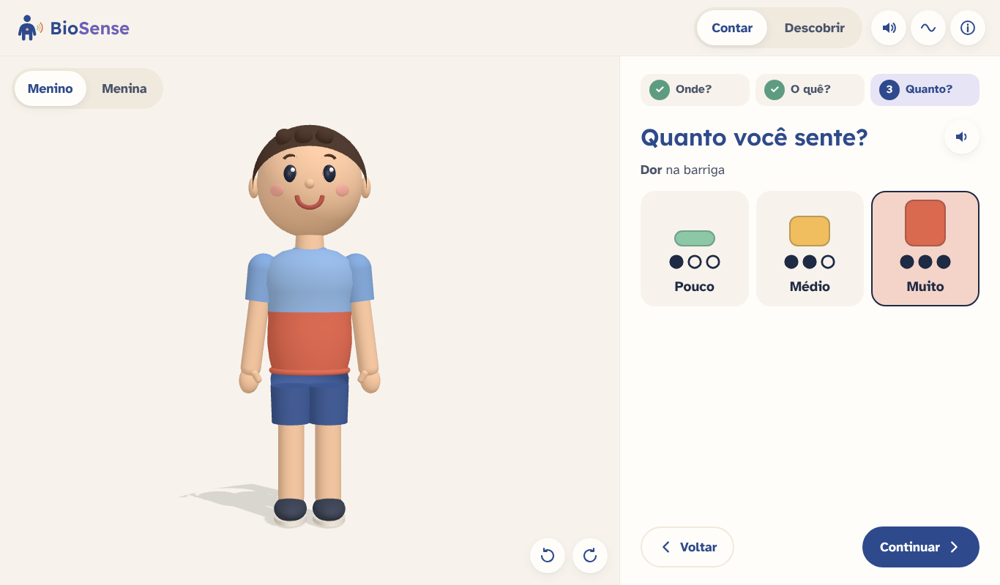 |

| Resumo (menino) | Resumo (menina) | Descobrir |
|---|---|---|
| 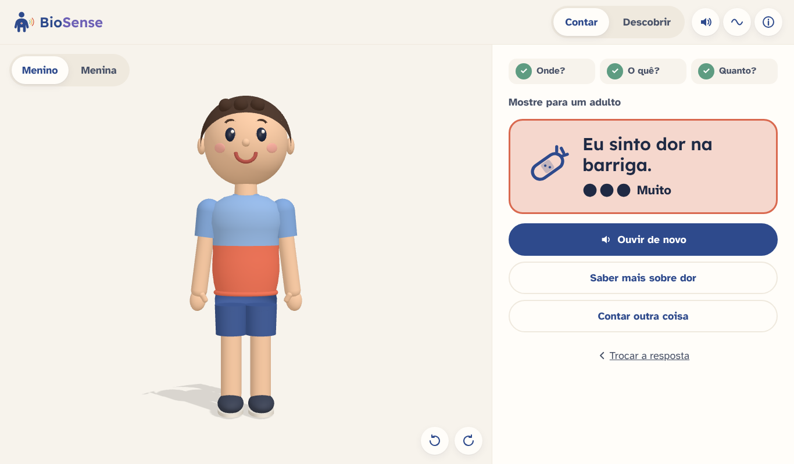 | 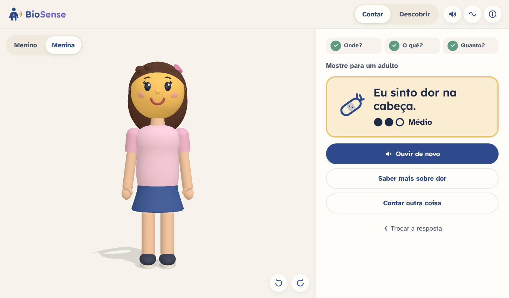 | 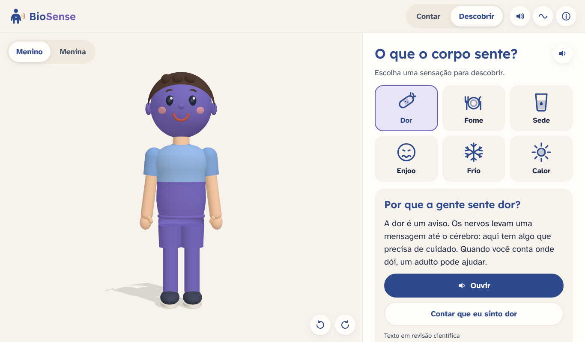 |

| Celular |
|---|
 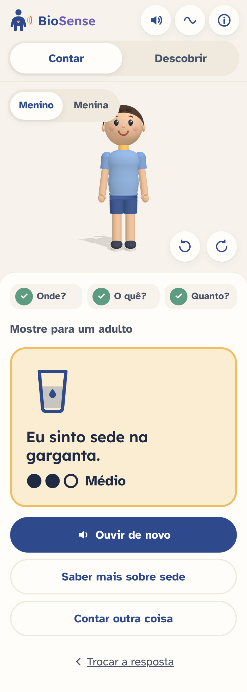 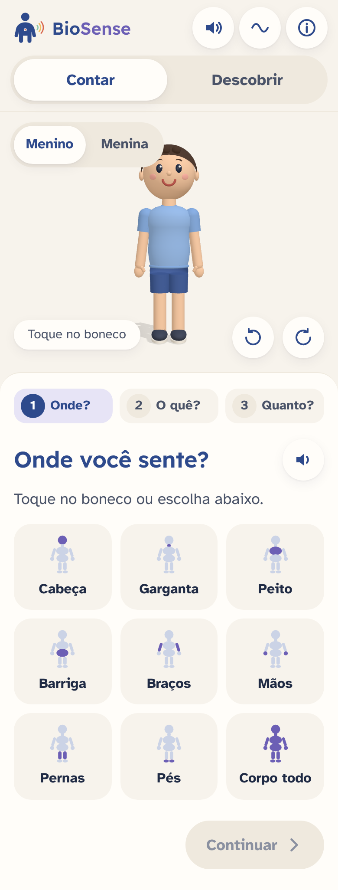 |

### Acessibilidade implementada

| Diretriz | No protótipo |
|---|---|
| Previsibilidade | Sempre 3 etapas na mesma ordem, indicador de progresso fixo, botões Voltar/Continuar sempre no mesmo lugar |
| Carga sensorial controlada | Transições de cor lentas, sem flash; botão para **desligar o som** e botão para **parar o movimento**; respeita a configuração "reduzir movimento" do aparelho; fundo Areia |
| Comunicação múltipla | Toda escolha tem pictograma + texto + voz; botão "ouvir de novo" em todas as telas |
| Sem pressão | Sem tempo, pontuação ou erro: qualquer resposta pode ser trocada |
| Autonomia e acesso | Alvos de toque de 56 px; funciona por toque, mouse e **teclado** (Tab/Enter); leitor de tela recebe avisos de cada escolha |
| Privacidade | Sem login, sem anúncios, sem chat, nada enviado para a internet. Só as preferências de som e movimento ficam salvas no próprio aparelho |
| Offline | PWA: depois do primeiro acesso, funciona sem internet e pode ser instalado na tela inicial do tablet |

### O que é provisório nesta versão

| Item | Na V1 | Na V2 |
|---|---|---|
| Bonecos 3D | Menino (camiseta, bermuda e tênis) e menina (cabelo comprido com laço, camiseta e saia), montados em formas 3D no código. Olhos e cabelo não mudam de cor; só pele e roupa da região tocada | Modelos do Blender da equipe MA3D, carregados de `public/modelos/boneco-menino.glb` e `boneco-menina.glb` ([como exportar](docs/modelo-blender.md)) |
| Voz | Voz sintetizada do navegador em pt-BR | Narração gravada pela equipe (o código já toca o arquivo indicado no JSON, se existir) |
| Pictogramas | Desenhos próprios simples | Avaliar troca por ARASAAC após escuta da instituição parceira |
| Textos do Descobrir | Rascunho, marcado como "em revisão científica" | Textos validados pela curadoria e pela Prof.ª Raphaela |

O protótipo **não usa dados mockados de usuários**: não há banco de dados nem coleta. O "dado" do app é o conteúdo em `public/conteudo/*.json`.

---

## Como executar

**Pré-requisito:** [Node.js](https://nodejs.org) 18 ou mais recente.

```bash
git clone https://github.com/joaorossoni1-eng/biosense.git
cd biosense
npm install
npm run dev
```

Abra o endereço que aparecer no terminal (normalmente `http://localhost:5173`). Para testar no celular na mesma rede Wi-Fi: `npm run dev -- --host` e abra o endereço "Network" no celular.

| Comando | O que faz |
|---|---|
| `npm run dev` | Servidor de desenvolvimento, recarrega a cada alteração |
| `npm run build` | Gera a versão final em `dist/` |
| `npm run preview` | Abre a versão final localmente (com modo offline ativo) |

**Publicação:** a cada `push` na branch `main`, o GitHub Actions ([`.github/workflows/deploy.yml`](.github/workflows/deploy.yml)) gera o build e publica no GitHub Pages. Na primeira vez, ative em **Settings → Pages → Source: GitHub Actions**.

**Editar o conteúdo sem programar:** textos, frases e cores da escala ficam em [`public/conteudo/`](public/conteudo/). Para trocar a explicação da fome, por exemplo, edite `sensacoes.json` e faça o commit.

### Tecnologias utilizadas

| Tecnologia | Versão | Uso |
|---|---|---|
| Three.js | 0.170 | Cena 3D, iluminação, giro do boneco (OrbitControls), toque nas regiões (Raycaster), carregamento de GLB (GLTFLoader) |
| Vite | 6 | Servidor de desenvolvimento e build |
| JavaScript (ES2022), HTML, CSS | — | Interface, sem framework |
| Web Speech API | — | Voz em pt-BR (provisória) |
| Service Worker + Web App Manifest | — | PWA e uso offline |
| Lexend e Atkinson Hyperlegible | OFL | Tipografia, incluída no projeto para funcionar offline |
| GitHub Actions + GitHub Pages | — | Publicação automática |
| Blender → glTF/GLB | — | Modelo final do boneco (V2) |

---

## 1. Descrição do problema

### Título oficial

**BioSense: O que eu sinto?** — sentidos e interocepção

### O problema

**Interocepção** é a capacidade de perceber o que acontece dentro do próprio corpo: fome, sede, dor, enjoo, frio, calor. É ela que permite à criança perceber que algo não vai bem e pedir ajuda.

Para muitas crianças com Transtorno do Espectro Autista (TEA), deficiência intelectual ou dificuldades de linguagem, **perceber** uma sensação e **comunicá-la** são dois desafios distintos:

- **Perceber:** a literatura científica aponta diferenças de interocepção no autismo, com relatos de pouca consciência de fome, sede, dor e necessidade de ir ao banheiro. Um estudo com crianças e adultos encontrou prejuízo na precisão interoceptiva em crianças autistas, mas não em adultos, o que reforça a importância de intervir na infância (Nicholson et al., 2019; Palser et al., 2019).
- **Comunicar:** mesmo quando percebe a sensação, a criança pode não ter palavras para dizer *o quê*, *onde* e *quanto*. Um "dói" pode significar dor de barriga leve ou dor forte no ouvido. Algumas crianças só demonstram a dor quando ela já está intensa.

O resultado é uma barreira de **saúde e bem-estar**: dores e desconfortos passam despercebidos, sobram crises que adultos interpretam como comportamento, e professores, cuidadores e terapeutas ficam sem uma ferramenta simples para perguntar "o que você está sentindo?".

No ensino de Ciências, o corpo humano costuma chegar por imagens 2D e termos técnicos. Falta um recurso que una **conhecimento do corpo** e **autoconhecimento**: aprender onde ficam a barriga e a garganta e, ao mesmo tempo, aprender a dizer "minha garganta está doendo muito".

### Recorte do projeto

O BioSense **não diagnostica** nem substitui profissionais de saúde. É um **apoio à comunicação** e à **educação sobre o corpo**, usado com mediação de um adulto (professor, terapeuta ou cuidador).

> **Pergunta do projeto:** como um boneco 3D interativo pode ajudar crianças com necessidades educacionais específicas a identificar e comunicar *o que* sentem, *onde* sentem e *com que intensidade*?

### Público-alvo e contexto

| | |
|---|---|
| **Usuário principal** | Crianças de aproximadamente 6 a 12 anos com TEA, TDAH, deficiência intelectual, dificuldades de linguagem ou outras necessidades educacionais específicas |
| **Mediadores** | Professores de sala comum e de AEE (Atendimento Educacional Especializado), terapeutas ocupacionais, fonoaudiólogos, psicólogos e famílias |
| **Contexto de uso** | Escola, sala de recursos, clínica/ONG ou casa, em tablet, celular ou computador, sempre com um adulto por perto |
| **Instituição parceira** | Escola ou ONG que atende esse público (a definir com os docentes; o produto final será doado a ela) |

### Bases de dados públicas e reais

**Dimensionamento do público (dados oficiais)**

| Base | O que mostra | Uso no projeto |
|---|---|---|
| **IBGE — Censo Demográfico 2022: Pessoas com Deficiência e Pessoas Diagnosticadas com TEA** ([notícia oficial](https://agenciadenoticias.ibge.gov.br/agencia-noticias/2012-agencia-de-noticias/noticias/43464) · [SIDRA](https://sidra.ibge.gov.br)) | 2,4 milhões de pessoas com diagnóstico de autismo no Brasil (1,2% da população), sendo cerca de 1,1 milhão de 0 a 14 anos. São Paulo é o estado com mais diagnósticos (547.545). O mesmo levantamento contou 14,4 milhões de pessoas com deficiência entre os brasileiros de 2 anos ou mais | Tamanho e faixa etária do público; recorte por estado e município para a instituição parceira |
| **INEP — Censo Escolar 2024** ([microdados](https://www.gov.br/inep/pt-br/acesso-a-informacao/dados-abertos/microdados/censo-escolar)) | As matrículas de estudantes com TEA na educação básica passaram de 636.202 (2023) para 918.877 (2024), alta de 44,4%; a educação especial cresceu 58,7% em relação a 2020 | Mostra a demanda crescente nas escolas por recursos acessíveis; recorte por município e etapa de ensino |

**Fundamentação científica (interocepção)**

| Fonte | Contribuição |
|---|---|
| Nicholson, T. et al. (2019). *Interoception is impaired in children, but not adults, with autism spectrum disorder.* Journal of Autism and Developmental Disorders | Diferença de interocepção concentrada na infância: justifica o foco em crianças |
| Palser, E. R. et al. (2019). *Dissociation in how core autism features relate to interoceptive dimensions: evidence from cardiac awareness in children.* Journal of Autism and Developmental Disorders | Revisa relatos de baixa percepção de fome, sede, dor e necessidades fisiológicas no autismo |
| Mass General — Lurie Center for Autism: *Autism and Interoception* | Material de divulgação para famílias; descreve dificuldade de identificar sensações e de perceber a dor antes que fique intensa |
| Mahler, K. *Interoception: The Eighth Sensory System* | Referência prática de atividades de interocepção usada por terapeutas |

**Recursos abertos que serão usados no produto**

| Recurso | Uso |
|---|---|
| **ARASAAC** — pictogramas de Comunicação Aumentativa e Alternativa ([arasaac.org](https://arasaac.org), licença CC BY-NC-SA) | Pictogramas das sensações e das partes do corpo, já familiares a muitas crianças que usam pranchas de comunicação |

> A curadoria científica (Processos Biológicos) vai revisar e ampliar esta lista na etapa de validação, incluindo artigos em português.

---

## 2. Proposta de solução tecnológica

### Como a solução ataca o problema

O BioSense é uma **aplicação web em 3D** com um boneco amigável que a criança gira e toca. A comunicação de uma sensação acontece em **três perguntas curtas, sempre na mesma ordem**:

```
1. ONDE?   →  a criança toca a parte do corpo no boneco 3D (a região acende devagar)
2. O QUÊ?  →  escolhe um pictograma de sensação (com áudio)
3. QUANTO? →  escolhe a intensidade em 3 níveis: pouco · médio · muito
        ↓
RESUMO: o boneco mostra a sensação no lugar certo e uma voz diz a frase completa
        "Eu sinto dor na barriga. Muito."  → a criança pode mostrar ao adulto
```

Além do modo **Contar** (comunicação), o produto terá um modo **Descobrir** com explicações curtas e cientificamente revisadas: *por que a gente sente fome?*, *o que o corpo faz quando sente frio?*. É aqui que entram os conteúdos de fisiologia de Processos Biológicos.

### Escopo do MVP (semestre 2026.2)

| Item | MVP |
|---|---|
| **6 sensações** | dor · fome · sede · enjoo · frio · calor |
| **8 regiões do corpo** | cabeça · garganta · peito · barriga · braços · mãos · pernas · pés |
| **Escala de 3 níveis** | pouco · médio · muito, codificada **ao mesmo tempo** por cor, número de bolinhas (●○○ / ●●○ / ●●●), tamanho e áudio, para não depender só da cor |
| **Saída** | tela-resumo com frase em texto + áudio, para mostrar ao adulto |
| **Modo Descobrir** | 1 explicação curta por sensação (6 no total) |

*A lista de sensações e regiões é a proposta inicial; a escolha final será validada pela curadoria científica e pela instituição parceira.*

### Requisitos de acessibilidade (das diretrizes do BioDesign Inclusivo)

- **Previsibilidade:** sempre as mesmas 3 etapas, indicador de progresso fixo, botões sempre no mesmo lugar.
- **Carga sensorial controlada:** sem flashes, transições lentas, som desligável, botão de pausa, fundo Areia em vez de branco puro.
- **Comunicação múltipla:** toda instrução em pictograma + áudio + texto curto.
- **Sem pressão:** sem cronômetro, pontuação, *game over* ou resposta "errada".
- **Autonomia:** alvos de toque grandes (mínimo de 48 px), repetir áudio a qualquer momento, funciona por toque, mouse e teclado.
- **Privacidade:** sem login, sem anúncios, sem chat e **nenhum dado da criança salvo ou enviado**. Tudo roda no próprio aparelho.

### Tecnologias

| Camada | Tecnologia | Justificativa |
|---|---|---|
| Modelagem e animação 3D | **Blender** | Gratuito e de código aberto, domínio da turma de MA3D; permite rig simples e animações curtas (respirar, apontar, tremer de frio) |
| Formato 3D | **glTF / GLB** (com compressão Draco) | Padrão aberto da web, leve para tablets. Cada região do corpo é uma malha com nome próprio (`regiao_barriga`), o que facilita a detecção do toque |
| Renderização web | **Three.js** | Biblioteca 3D mais usada na web, com muita documentação; detecção de toque por *raycasting* nas malhas das regiões |
| Interface | **HTML, CSS e JavaScript** com **Vite** | Sem framework pesado: menos coisa para aprender e depurar no semestre; Vite dá servidor local rápido e build otimizado |
| Conteúdo | **Arquivos JSON** (`sensacoes.json`, `regioes.json`) | Textos, áudios e pictogramas ficam fora do código: a equipe de Processos Biológicos edita o conteúdo sem mexer na programação |
| Áudio | Narração **gravada pela equipe** (MP3/OGG) | Voz humana, calma e consistente; funciona sem internet. Leitura por voz sintetizada do navegador fica como alternativa |
| Pictogramas | **ARASAAC** + ícones próprios | Linguagem visual que muitas crianças já conhecem das pranchas de comunicação |
| Uso offline | **PWA** (Progressive Web App) | Pode ser instalada no tablet da escola e usada sem internet, como pede o pacote de entrega |
| Publicação | **GitHub Pages** | Gratuito, integrado a este repositório, publica a cada atualização |
| Qualidade | **Lighthouse** e **axe DevTools** | Testes automáticos de acessibilidade e desempenho, somados aos testes cruzados com outros grupos |

### Viabilidade no semestre

- **Escopo fechado:** um único boneco, 8 regiões, 6 sensações e 3 níveis. Combinações ficam para depois.
- **Sem backend:** sem servidor, banco de dados ou login. Isso reduz o risco técnico e atende à diretriz de privacidade.
- **Divisão clara:** MA3D cuida do boneco, das animações e da integração; Processos Biológicos cuida do conteúdo, da linguagem, do glossário e da validação. Os dois lados se encontram nos arquivos JSON.
- **Plano por checkpoint:**
  - **Checkpoint 2 (V1):** boneco com as 8 regiões clicáveis, fluxo completo onde → o quê → quanto → resumo, com áudio.
  - **V2:** ajustes dos testes, modo Descobrir completo, versão offline (PWA) e guia pedagógico.

---

## 3. Identidade visual

Arquivos em [`assets/identidade/`](assets/identidade/). Guia completo em [`docs/identidade-visual.md`](docs/identidade-visual.md).

### Logo

| Principal | Negativo | Símbolo |
|---|---|---|
|  | 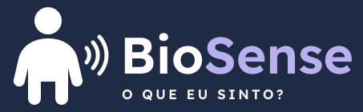 | 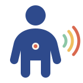 |

**Conceito:** um boneco simples e acolhedor, com um ponto na barriga — o lugar onde *algo é sentido*. Dele saem três ondas que crescem em tamanho e mudam de cor: são os **três níveis da escala** (pouco, médio, muito). O logo já mostra o que o produto faz: onde sinto, e quanto.

### Paleta de cores

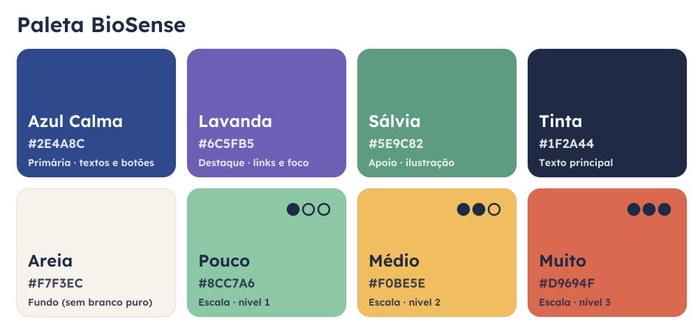

| Cor | HEX | Uso | Contraste |
|---|---|---|---|
| Azul Calma | `#2E4A8C` | Cor primária, títulos, botões | 7,7:1 sobre Areia (AAA) |
| Lavanda | `#6C5FB5` | Destaques, foco, links (conversa com o roxo do BioDesign Inclusivo) | 4,8:1 sobre Areia (AA) |
| Sálvia | `#5E9C82` | Ilustração e apoio, **não usar em textos pequenos** | 2,9:1 |
| Tinta | `#1F2A44` | Texto principal | 12,9:1 sobre Areia (AAA) |
| Areia | `#F7F3EC` | Fundo: reduz o brilho do branco puro | — |
| Pouco | `#8CC7A6` | Escala, nível 1 · ●○○ | Texto Tinta sobre ela: 7,4:1 |
| Médio | `#F0BE5E` | Escala, nível 2 · ●●○ | Texto Tinta sobre ela: 8,3:1 |
| Muito | `#D9694F` | Escala, nível 3 · ●●● | Texto Tinta sobre ela: 4,1:1 (texto grande) |

**Por que essas cores:** tons suaves e pouco saturados para não sobrecarregar a visão; contraste de texto dentro das recomendações WCAG; e a escala de intensidade **nunca depende só da cor** (sempre acompanhada de bolinhas e áudio), o que inclui crianças com daltonismo.

### Tipografia

| Uso | Fonte | Por quê |
|---|---|---|
| Títulos e logo | **[Lexend](https://fonts.google.com/specimen/Lexend)** (SemiBold) | Criada para melhorar a fluência de leitura, com letras abertas e espaçadas |
| Textos e interface | **[Atkinson Hyperlegible](https://fonts.google.com/specimen/Atkinson+Hyperlegible)** (Regular e Bold) | Criada pelo Braille Institute para baixa visão: letras parecidas (I, l, 1 / O, 0) são bem diferentes entre si |

Ambas são gratuitas (SIL Open Font License) e funcionam offline. Regras: frases curtas, texto mínimo de 18 px na interface infantil, alinhamento à esquerda, nada de texto todo em maiúsculas para as crianças.

---

## 4. Pitch inicial

> Quando uma criança autista ou com dificuldade de linguagem sente dor, fome ou enjoo, nem sempre ela consegue perceber isso com clareza, e mais difícil ainda é dizer *onde* e *quanto*. No Brasil, são 2,4 milhões de pessoas com diagnóstico de autismo, cerca de 1,1 milhão delas até 14 anos, e mais de 918 mil estudantes com TEA nas escolas. O **BioSense** é um boneco 3D que a criança gira e toca para contar o que sente em três passos simples: **onde**, **o quê** e **quanto**. No fim, o boneco "fala" a frase completa para o adulto. Ao mesmo tempo, a criança aprende sobre o próprio corpo com explicações revisadas cientificamente. Gratuito, sem login, sem coleta de dados e funcionando até sem internet, o BioSense será doado à instituição parceira e transforma uma pergunta difícil — *"o que você está sentindo?"* — em uma conversa possível.

### Diferencial perante as opções existentes

| Opção existente | Limitação | O que o BioSense faz diferente |
|---|---|---|
| **Escalas de dor com rostos** (ex.: Wong-Baker) | Medem *quanto* dói, mas não *onde* nem *o quê*; dependem de interpretar expressões faciais, o que pode ser difícil para crianças autistas | Junta onde + o quê + quanto num único fluxo, sem depender de expressões faciais |
| **Mapas do corpo em papel** | Estáticos, 2D, sem áudio e sem retorno | Boneco 3D que gira, acende a região tocada e fala o resultado |
| **Apps de comunicação alternativa (CAA)** | Pranchas genéricas com centenas de símbolos; sensações do corpo ficam "escondidas" em categorias | Feito só para sensações do corpo: poucas opções, sempre na mesma ordem, carga cognitiva baixa |
| **Apps educativos de anatomia** | Ensinam nomes de órgãos, mas não ligam o corpo ao que *eu* sinto; costumam ter pontuação, tempo e anúncios | Une aprendizagem do corpo e comunicação do que se sente, sem pontuação, tempo ou anúncios |

**Em uma frase:** o BioSense é desenhado desde o início para a interocepção, com acessibilidade como requisito, conteúdo validado cientificamente e testado com a instituição que vai usá-lo.

---

## 5. Equipe

| Integrante | RA | Papel principal | GitHub |
|---|---|---|---|
| Jessica _(sobrenome)_ | _preencher_ | Curadoria científica e bases de dados | _@usuario_ |
| Lara _(sobrenome)_ | _preencher_ | Conteúdo, linguagem e glossário | _@usuario_ |
| Fernanda _(sobrenome)_ | _preencher_ | Acessibilidade e testes | _@usuario_ |
| Yan _(sobrenome)_ | _preencher_ | Modelagem 3D e animação | _@usuario_ |
| João Vitor _(sobrenome)_ | _preencher_ | Desenvolvimento, integração e identidade visual | [@joaorossoni1-eng](https://github.com/joaorossoni1-eng) |

> Cada integrante completa a própria linha (nome completo, RA e usuário do GitHub) com a própria conta. Essa edição já conta como a sua contribuição registrada no histórico.

**Docentes:** Prof.ª Dra. Raphaela Pascarelli (Processos Biológicos) · Prof. Hercules Ramos (Modelagem e Animação 3D | Inteligência Artificial)

Como cada integrante contribui no repositório: [`docs/como-contribuir.md`](docs/como-contribuir.md).

---

## 6. Organização do repositório

```
biosense/
├── index.html                   ← página do app
├── src/
│   ├── js/
│   │   ├── main.js              ← fluxo onde → o quê → quanto → resumo e modo Descobrir
│   │   ├── boneco.js            ← cena 3D, boneco, regiões tocáveis, carregamento do GLB
│   │   ├── voz.js               ← áudio: arquivo gravado ou voz do navegador
│   │   └── icones.js            ← pictogramas, bolinhas da escala e mini-boneco
│   └── css/estilo.css           ← tokens da identidade visual e layout
├── public/
│   ├── conteudo/                ← sensacoes.json, regioes.json, escala.json (editáveis)
│   ├── modelos/                 ← boneco-provisorio-menino/menina.glb (base para o Blender); boneco-menino/menina.glb na V2
│   ├── audio/                   ← narrações gravadas (V2)
│   ├── fontes/  icones/         ← fontes offline e ícones do app
│   ├── manifest.webmanifest     ← PWA
│   └── sw.js                    ← modo offline
├── assets/identidade/           ← logo, símbolo e paleta
├── docs/
│   ├── prints/                  ← capturas do protótipo
│   ├── identidade-visual.md     ← guia da marca
│   ├── conteudo-mvp.md          ← conteúdo para curadoria científica
│   ├── modelo-blender.md        ← como exportar o boneco do Blender
│   ├── roteiro-video.md         ← roteiro do vídeo de demonstração
│   └── como-contribuir.md       ← fluxo de commits da equipe
└── .github/workflows/deploy.yml ← publicação no GitHub Pages
```

### Próximos passos (rumo à V2)

- [x] Estrutura do projeto (Vite + Three.js) e fluxo principal funcionando
- [x] Bonecos com as 8 regiões tocáveis e opção "corpo todo"
- [x] Controles de som e movimento, teclado e modo offline
- [x] Escolha entre boneco menino e menina
- [ ] Modelos finais no Blender (`public/modelos/boneco-menino.glb` e `boneco-menina.glb`)
- [ ] Narração gravada pela equipe (`public/audio/`)
- [ ] Revisão científica dos textos do modo Descobrir
- [ ] Testes cruzados com outros grupos (16/11 a 19/11) e relatório de melhorias
- [ ] Feedback da instituição parceira e guia pedagógico

---

<sub>BioSense · FMU Tech Inovação 2026.2 · BioDesign Inclusivo | Compartilhe Docência Level Up · Centro Universitário FMU</sub>
